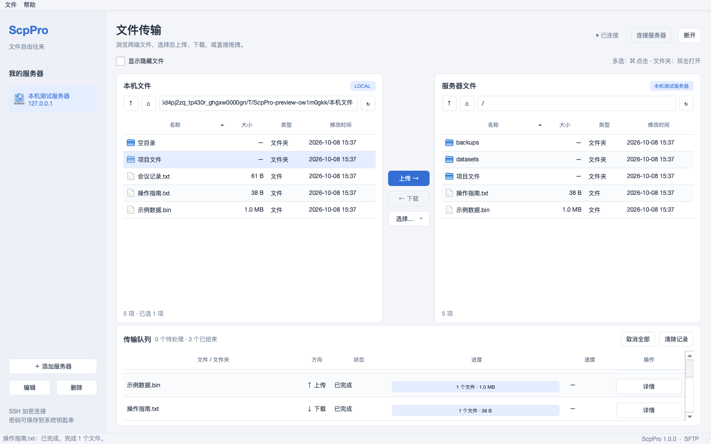

# ScpPro

中文 macOS 桌面工具，通过 SSH/SFTP 在本机与指定 IP 的服务器之间上传、下载文件和文件夹。



## 直接使用

1. 双击 `dist/ScpPro.app`，或将它拖入“应用程序”目录。应用已包含 Python 与所需依赖。
2. 点击“添加服务器”，填写名称、IP、SSH 端口（默认 22）和用户名。
3. 选择密码登录或 SSH 私钥；加密私钥需填写口令。勾选钥匙串选项后，凭据在成功登录后保存。
4. 点击“连接服务器”。首次连接会显示主机指纹，请核对后点击“信任并连接”。
5. 左侧浏览本机，右侧浏览服务器。目标是另一侧当前打开的目录；多选后点击“上传”或“下载”，也可跨栏拖拽。
6. 可将 Finder 的文件或文件夹拖入右侧；拖到一个文件夹行上会传入该文件夹。“选择…”菜单也可上传其他位置的文件或文件夹。

服务器需已启用 SSH 的 SFTP 子系统，登录账户需具备源目录读取及目标目录写入权限。首版应用支持 Apple 芯片 Mac，最低系统要求 macOS 13；已在当前 macOS 26 环境验证。

## 传输行为

- 文件夹传输保留目录层级和空目录，包含隐藏文件。同名文件夹合并，已有其他文件保留。
- 同名文件提供覆盖、跳过、保留两份，支持将选择应用于当前批次。保留两份使用 `name (1).ext` 等名称。
- 文件先写入目标目录的随机隐藏临时文件，完整传输并核对大小后才提交。取消或失败时已有文件保留。
- 远程覆盖使用 `posix_rename` 扩展。服务器不支持安全覆盖时任务失败，可重试并选择“保留两份”。
- 符号链接、设备等特殊文件跳过；目标中的符号链接不会被递归写入。所有跳过、失败和清理提示可查看队列“详情”。
- 队列按批次顺序运行。取消关闭当前传输通道，文件浏览连接保留；失败和取消任务可从头重试未完成项。
- 网络断开时暂停等待中的批次，重新连接原服务器后继续。任务固定绑定服务器及完整路径。
- 不做断点续传。已完成文件不会因为重试未完成项而重新传输；扫描阶段失败时会重新扫描整个批次。
- 传输采用流式读写，文件内容不会一次性载入内存。文件修改时间尽量保留，不复制所有权、扩展属性或完整权限信息。
- 完成校验为字节数及源文件大小/修改时间检查；集成测试另外比较 SHA-256，应用本身不额外读取全文件计算哈希。
- 断网后无法联系服务器时，隐藏临时文件可能无法删除。“详情”会列出路径，供网络恢复后清理。

## 连接与配置

配置与主机密钥保存在 `~/Library/Application Support/ScpPro/`：

| 文件 | 内容 |
| --- | --- |
| `profiles.json` | 服务器列表、端口、用户名、认证方式、私钥路径和最近目录 |
| `known_hosts` | 用户明确确认的服务器主机密钥 |

密码和私钥口令默认仅保留在当前应用会话中；勾选记住后保存到 macOS 钥匙串，服务名称为 `ScpPro`。取消记住或删除连接会移除对应钥匙串条目。私钥内容不复制到应用配置，密码与私钥口令不写入配置或日志。

主机密钥变更时连接会被阻止。确认服务器确实已重装或合法换钥后，退出应用并备份 `known_hosts`，移除该服务器对应的记录，然后重新连接核对新指纹。应用不会自动接受变更。

首版为本地使用的应用包，采用本机临时签名；不包含 Developer ID 公证或 App Store 发布。

## 开发运行

需要 Python 3.13。

```bash
python3 -m venv .venv
.venv/bin/python -m pip install -r requirements.lock
.venv/bin/python -m pip install -e . --no-deps
.venv/bin/python -m scppro
```

快捷键：`⌘N` 添加服务器、`⌘K` 连接、`⌘D` 断开、`⌘U` 选择文件上传、`⌘⇧U` 选择文件夹上传、`⌘⇧D` 下载选中项。

## 测试与构建

```bash
# 测试使用临时目录和仅监听 127.0.0.1 的 SSH/SFTP 服务
.venv/bin/python -m pytest -q

# 在 Apple 芯片 Mac 上构建应用与 ZIP
.venv/bin/python scripts/build.py

# 从临时工作目录独立启动，并验证 macOS 原生启动与签名
.venv/bin/python scripts/check_bundle.py

# 打开构建结果
open dist/ScpPro.app
```

测试无需远程服务器凭据，不修改系统 SSH 配置，也不写入个人钥匙串。测试覆盖真实 SSH/SFTP 协议读写、密码/私钥认证、主机密钥、目录往返、同名文件、权限错误、取消、网络断开、失败重试和 Qt 界面流程。

项目采用界面、存储、SSH 会话和传输核心分层，后台工作线程通过 Qt 信号更新界面。每个线程使用独立 SFTP 通道，同一时间执行一个传输批次。

运行 `.venv/bin/python scripts/preview.py` 可在临时 SFTP 服务上执行上传下载并生成浅色、深色及连接窗口预览；预览文件位于 `artifacts/`。

`SCPPRO_DATA_DIR` 可覆盖应用数据目录以进行隔离验证；`SCPPRO_SMOKE_SECONDS` 可在指定秒数后自动关闭应用，用于打包启动检查。
